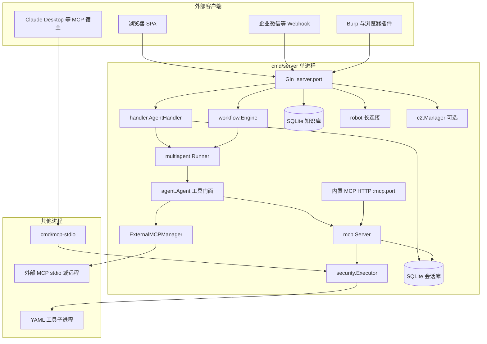
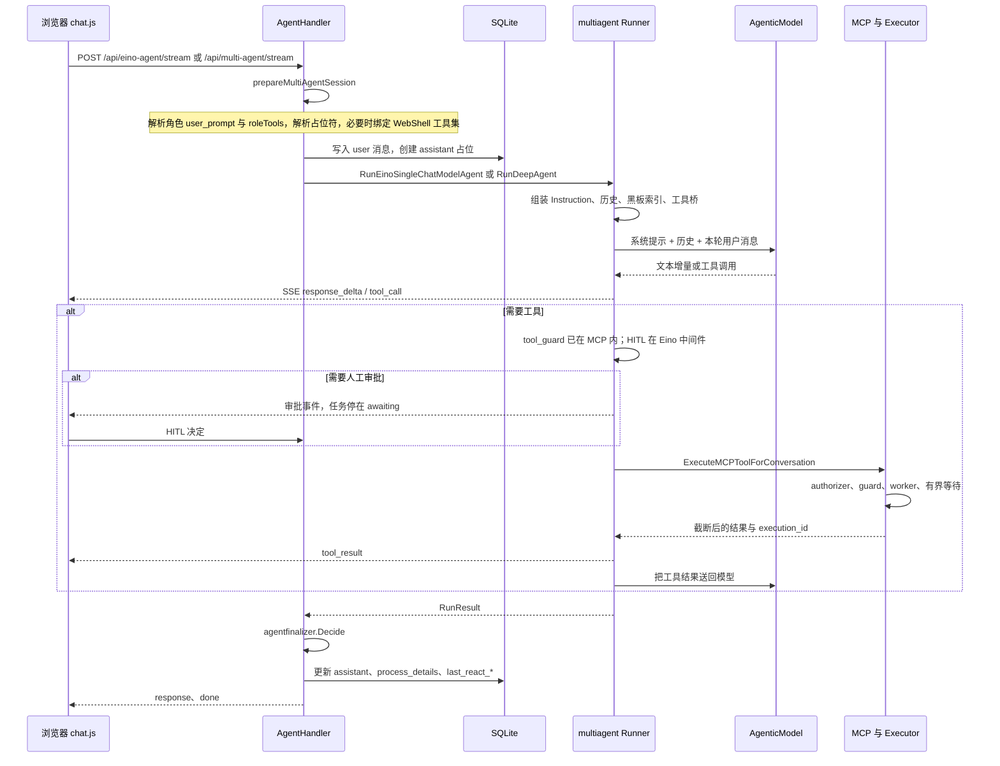
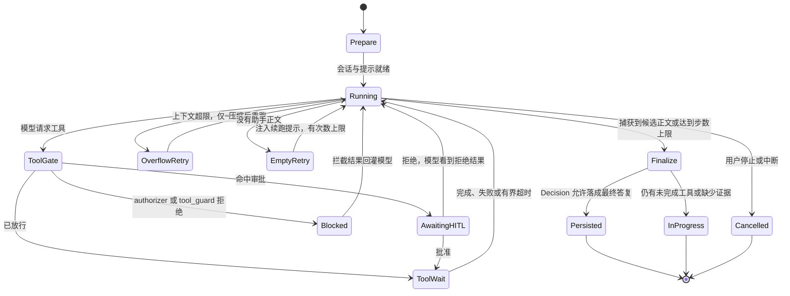

# CyberStrikeAI 代码架构与实现

本文是对仓库 [Silver-cybersec/CyberStrikeAI](https://github.com/Silver-cybersec/CyberStrikeAI) 的只读静态分析，对照的是分析时的 `main`（`b43bdb99`）。阅读方式是打开源码与 `docs/zh-CN/`，没有启动服务、没有安装依赖、没有构建或拉取镜像、也没有向任何目标发请求。

仓库里没有 `SECURITY_AUDIT.md`。安全边界以 [docs/zh-CN/security-model.md](docs/zh-CN/security-model.md) 和 [docs/zh-CN/security-hardening.md](docs/zh-CN/security-hardening.md) 为准。更短的模块总览见 [docs/zh-CN/architecture.md](docs/zh-CN/architecture.md)；多代理改造记录见 [docs/zh-CN/MULTI_AGENT_EINO.md](docs/zh-CN/MULTI_AGENT_EINO.md)。本文补的是「代码怎么把这些设计落下来」。

高风险子系统（本地命令、WebShell、内置 C2、外部 MCP）只写到模块边界、注册点和治理闸门。不展开监听协议、载荷生成、加密实现或具体测试命令。

---

## 1. 一句话定位与适用场景

CyberStrikeAI 是一个跑在单个 Go 进程里的授权安全任务工作台：自然语言意图交给 CloudWeGo Eino ADK 代理，经 MCP 工具执行，证据、项目事实和人工审批留在同一套 SQLite 与本地文件里。

它适合这些用法：

- 已获授权的安全测试或演练，需要把规划、执行、审批、证据和复盘放在一个可审计界面里。
- 同一套执行核要同时服务 Web 控制台、IM 机器人、Burp / 浏览器插件，以及给外部宿主用的 stdio MCP。
- 团队希望用角色缩小模型看得见的工具，再用 RBAC、调用拦截和人机协同（HITL）决定能不能真的执行。

它不适合被当成这些东西：

- 无状态、多副本的通用聊天服务。会话库是 SQLite，任务取消、机器人长连接和 C2 监听器都活在进程内存里。
- 自带全部扫描能力的独立扫描器。扫描与分析能力来自 `tools/` 的 YAML 配方、Skills 目录和外部 MCP，由本进程拉起或转发。
- 把管理面和高权限工具拆到不同信任域的设计。Web、Agent、命令执行、可选的 WebShell 与 C2 默认在同一进程，隔离靠部署，不靠进程边界。

---

## 2. 核心理念与设计取舍

README 把产品收成三句：意图变成受治理的行动，证据变成运营记忆，一次行动改善下一次行动。代码里这三句分别落在提示词组装、执行闸门，以及项目黑板和轨迹回放上。

### 2.1 三层是怎么分开的

| 层 | 代码里实际做什么 | 不做什么 |
| --- | --- | --- |
| 意图 | 用户消息、角色 `user_prompt`、编排系统提示、项目范围与黑板索引 | 不把角色提示当成系统消息；角色只拼在用户消息前面 |
| 治理 | 角色工具子集、RBAC authorizer、`tool_guard` 正则、HITL、进程隔离、输出上限 | 模型口头同意或系统提示里的「已授权」不能打开这些闸门 |
| 记忆 | `messages`、`conversations.last_react_*`、`process_details`、`tool_executions`、`project_facts`、压缩快照 | 自动摘要不是已确认事实，也不能当成新的授权 |

「下一次更好」靠的是：压缩后把续接笔记写成 `note/context-*`，下一轮只注入索引而不是全文；工具大输出落到文件，模型以后用读文件工具分段回看；攻击链节点要能对上轨迹里的工具调用 ID。

### 2.2 和常见 ReAct 的异同

经典 ReAct 是单循环：模型产生思考，决定调用工具，读到观察，再继续，直到它自己停。本仓库曾经有这条自研循环，文档写明已经删除（`/api/agent-loop` 不再是执行入口，见 `docs/zh-CN/MULTI_AGENT_EINO.md`）。`internal/agent` 里现在没有 `AgentLoop` 一类方法。

现在的单代理仍然是「模型 ↔ 工具」循环，但循环在 Eino ADK 的 `TypedChatModelAgent[*schema.AgenticMessage]` 里，入口是 `multiagent.RunEinoSingleChatModelAgent`。本仓库包在外面的是：

- 工具调用前的中间件（参数兼容、RBAC、HITL、软恢复）。
- 有界等待：阻塞工具在 worker 里跑，代理等到 `tool_wait_timeout_seconds` 就拿回 `execution_id`，下一轮再查。
- 空回复续跑、上下文溢出后的一次压缩重试、模型通道的 retry / failover。
- `agentfinalizer.Decision`：助手正文只是候选，要等证据与挂起工具核对后才算最终答复。

列名 `last_react_input` / `last_react_output` 是兼容旧名。注释写明它保存的是全模式代理轨迹，不是旧 ReAct 专用状态。

还有一处容易看错的遗留：`agent.Agent.maxIterations` 在 `NewAgent` 里默认写成 30，`app.New` 在配置 ≤0 时也传 30，但生产代码只写入、不读取。真正卡住循环的是 `multiagent.agentMaxIterations`（配置 `agent.max_iterations`，未配置时 3000）。示例配置写的是 12000。三套数字并存，见第 10 节。

### 2.3 和 Planner-Executor 的异同

`plan_execute` 最接近教科书里的规划器—执行器：

- 规划器与重规划器走经典 `ChatModel`，不挂 MCP 工具链。原因写在多代理文档里：当前 Eino 官方 Planner / Replanner 仍是经典消息接口。
- 执行器是 Agentic typed agent，工具中间件与 Deep 主路径同源，再经 adapter 接回官方 `planexecute` 的 session contract。
- 外层 execute ↔ replan 次数由 `multi_agent.plan_execute_loop_max_iterations` 限制，0 表示用 Eino 默认 10。
- 规划器的「用户」消息是系统生成的计划模板。轨迹里用独立来源标记，避免压缩时把模板当成用户新指令或新授权。

和常见自研 Plan-and-Execute 的差别：计划不是本仓库自己的任务表。应用侧持久化的是对话轨迹和工具执行，不是一份可单独查询的计划 DAG。`plan_execute` 也不加载 Markdown 子代理；子代理只属于 Deep 与 Supervisor。

### 2.4 和常见 Multi-agent 的异同

仓库同时提供两种多代理，都从 `RunDeepAgent` 进入，用请求体 `orchestration` 分支：

- **Deep**：一个协调主代理加 `task` 工具，把子任务派给 `agents/*.md` 里的专家。`noNestedTaskMiddleware` 放在中间件最外层，子代理不能再派子代理。这不是对等群聊，也不是每个专家一个长期进程。
- **Supervisor**：`supervisor.New`，主代理用 `transfer_to_agent` / `exit` 做专家路由。至少一个子代理；只有一个时会打一条进度提示，说明路由空间有限，然后继续。

和常见多代理框架的差别：

- 专家没有各自的长期记忆库。跨会话共享的是项目事实；自动续接笔记默认只对当前会话可见。
- 子代理的 `bind_role` 只继承该角色的工具列表，不继承角色提示词。提示词在 Markdown 正文或 YAML `instruction`。
- 所有编排最后都进同一个 `runEinoADKAgentLoop`，SSE 事件形状与单代理共用。前端不用为每种编排写一套协议。
- 另有一条图工作流（`internal/workflow`）：节点是 start / tool / agent / condition / hitl / output / end，由 Eino `compose.Workflow` 编译。它是可复用流程图，不是 Deep 的 `task` 委派。

### 2.5 故意留下的取舍

**单体 Go + SQLite + 静态页面。** `cmd/server` 把 Gin、内置 MCP HTTP、Agent、工作流、机器人长连接和可选 C2 放在一个进程。部署门槛低。代价是 SQLite 写入、内存里的任务租约和监听器都不能靠多加副本解决。`docs/zh-CN/architecture.md` 把这一点写成部署边界，而不是缺陷。

**提示词里的授权口吻，和运行时闸门是两套机制。** 内置单代理与 plan_execute 提示把「授权已由部署方事先裁决，不要在对话里反复向操作者确认是否获准」写成模型行为。这只影响模型怎么说话、会不会停下来问。能不能执行，取决于角色工具集、RBAC、`tool_guard`、HITL 和进程隔离。提示词不能扩大这些闸门。部署时如果要收紧行为，应改提示文件或 Markdown，并同时收紧角色工具与审批，而不是只改其中一层。

**聊天续跑不走 ADK checkpoint。** `RunDeepAgent` 与 `RunEinoSingleChatModelAgent` 都把 `CheckpointDir` 传成空字符串，注释说明 ADK checkpoint 会变成第二条模型状态通道，和用户轮次、`last_react_*` 容易不一致。工作流有自己的断点目录，不要和聊天续跑混用。

**工具默认短描述，多了再检索。** `security.tool_description_mode` 默认 `short`。工具数量达到 `tool_search` 阈值后，多数工具从模型的常驻列表挪到按名检索。模型看见的工具集合，不等于服务器上注册的工具集合。

**大输出先截断再给模型。** 数据库里存的是截断并可能落盘之后的那一份，和模型看到的一致。原文路径留在提示里，需要时再读。这样避免把一次扫描的全部输出灌进下一轮上下文，也避免恢复历史时把超大字段再次送进模型。

---

## 3. 整体架构图

### 3.1 组件与进程

实线框里是 `cmd/server` 一个进程。虚线框是别的进程或外部客户端。



进程边界可以记成五条：

1. **主进程** `cmd/server/main.go`：加载配置、进程隔离自检、`app.New`、`RunWithContext`。SIGINT / SIGTERM 时 `Shutdown`。
2. **第二个监听**只在 `mcp.enabled` 时出现：`App.RunWithContext` 在 `mcp.host:mcp.port`（示例 `127.0.0.1:8081`）上提供 `/mcp`。它仍是本进程里的 goroutine，不是独立服务。
3. **`cmd/mcp-stdio`** 是精简 MCP：只注册 YAML 工具和执行控制工具，JSON-RPC 走 stdio，日志走 stderr。没有 Web、没有 Agent、没有数据库。
4. **外部 MCP** 由 `ExternalMCPManager` 按 `stdio` / `sse` / `http` 拉起或连接。子进程生命周期归主进程。
5. **YAML 工具** 是 `security.Executor` 拉起的命令子进程，受 `security.process_isolation` 与任务级 `ProcessScope` 约束。C2 监听器若启用，也是主进程里的 goroutine，不是独立 C2 二进制。

机器人分两类，都在主进程：企业微信等走 `/api/robot/*` Webhook；飞书、钉钉、Telegram、Slack、Discord、QQ、微信 iLink 另有长连接 goroutine，配置变更时用 `App` 上的 `cancel` 函数重启。

### 3.2 一次典型对话的时序

下面是 Web 上一次流式单代理或 Deep 任务。工作流、批量队列和机器人最后都汇入同一 Runner，差别在入口函数和有没有 SSE。



对应的运行状态可以看成：



有界超时不是失败。`mcp.Server.CallTool` 在 `ErrExecutionWaitTimeout` 时返回「仍在后台运行」的结果和 `execution_id`。模型可以调用 `get_tool_execution` / `wait_tool_execution` / `cancel_tool_execution` 接着管这一次执行。

「中断并继续」优先走 Eino `TurnLoop`：把用户补充推进当前轮，而不是整段任务取消。未注册或推进失败时，才退回原生 cancel，再用轨迹续跑。

---

## 4. 目录与模块地图

| 路径 | 职责 |
| --- | --- |
| `cmd/server/` | 主进程入口、更新/回滚子命令、进程隔离探测、管理员密码重置 |
| `cmd/mcp-stdio/` | 给外部宿主用的 stdio MCP，只有工具执行 |
| `internal/app/` | 组装：数据库、MCP、Executor、Agent、知识库、机器人、C2、路由 |
| `internal/config/` | `Config` 与环境变量展开、工具目录合并、HITL / 模型默认值 |
| `internal/handler/` | HTTP。Agent 对话、配置热更新、项目、漏洞、工作流、审计都在这里 |
| `internal/agent/` | 工具门面与 `ChatMessage`。系统提示默认文案在这里，循环不在这里 |
| `internal/multiagent/` | 单代理与三种多代理的 Runner、中间件、重试、轨迹、SSE 事件映射 |
| `internal/agents/` | 解析 `agents/*.md` 的 front matter，并与 YAML `sub_agents` 合并 |
| `internal/einomcp/` | 把 `agent.Tool` 桥成 Eino Tool，执行仍回到 `Agent.ExecuteMCPToolForConversation` |
| `internal/mcp/` | 内置 MCP Server、外部 MCP、执行服务、结果截断、调用拦截挂钩 |
| `internal/security/` | 登录与 RBAC 会话、命令执行器、进程作用域 |
| `internal/toolguard/` | 工具名与参数的正则拦截 |
| `internal/hitl/` | 审计代理裁决辅助与审批日志保留 |
| `internal/processguard/` | 任务进程组 / cgroup 隔离与启动自检 |
| `internal/runlease/` | 进程内取消租约，不是数据库表 |
| `internal/openai/`、`internal/llm/`、`internal/reasoning/` | OpenAI 兼容 HTTP、Claude Agentic 适配、推理字段 |
| `internal/knowledge/` | 扫描、分块、嵌入、向量检索、重排、MCP 检索工具 |
| `internal/project/`、`internal/projectprompt/` | 黑板索引块与提示片段 |
| `internal/workflow/` | 图校验、编译成 Eino Workflow、HITL 暂停与恢复 |
| `internal/attackchain/` | 从轨迹和工具记录生成攻击链，并可用事实沉淀回项目 |
| `internal/agentfinalizer/` | 候选回复能不能当成最终答复 |
| `internal/report/` | 用数据库快照生成 DOCX，不再次调用模型或工具 |
| `internal/robot/` | IM 接入，最终调用 `ProcessMessageForRobot` |
| `internal/audit/`、`internal/monitor/`、`internal/storage/` | 平台审计、工具执行保留、磁盘分类清理 |
| `internal/database/` | SQLite 访问；权威表结构在 `schemas/application.sql` 与 `schemas/knowledge.sql` |
| `internal/c2/`、`internal/handler` 中的 WebShell | 可选的高风险操作面，经同一套 RBAC 与 HITL |
| `agents/` | Deep / Plan-Execute / Supervisor 主代理与专家 Markdown |
| `roles/` | 测试角色 YAML：`user_prompt` + 可选 `tools` |
| `skills/` | Agent Skills。运行时由 Eino `skill` 中间件按需读取 |
| `tools/` | YAML 命令配方，由 `security.tools_dir` 加载 |
| `knowledge_base/` | 知识库源 Markdown |
| `web/templates/index.html` + `web/static/js/` | 无前端打包步骤的哈希路由页面 |
| `plugins/` | 仓库外客户端：Burp 扩展与浏览器扩展，只调 HTTP API |
| `docs/zh-CN/` | 产品与运维文档。和代码不一致的地方见第 10 节 |

`internal/handler` 大约一百六十个 Go 文件，按业务拆分，而不是按层再分目录。路由集中在 `internal/app/app.go` 的 `/api` 组。

---

## 5. 核心实现

### 5.1 入口与配置

`cmd/server/main.go` 的 `main` 先解析标志，再 `config.EnsureLocalConfig` 与 `config.Load`。本地还没有配置文件时，会从示例复制出 `config.yaml`。随后做进程隔离探测 `processguard.Check`，必要时为 MCP 生成认证头并写回文件，然后 `app.New`。

`app.New` 的顺序决定了依赖方向，后面的热更新也要守住这个顺序：

1. `toolguard.NewManager(cfg.EffectiveToolGuard())`，再 `multiagent.InitADK()`。
2. `database.NewDB`。缺表缺列由嵌入的 SQL 与 `schema_reconcile` 补齐，不另写一套启动期 `ALTER` 清单（见 `internal/database/schemas/README.md`）。
3. `security.NewAuthManager`，`AttachRBACStore`。首次启动可能打印引导用的 admin 密码。
4. 审计、监控、HITL 的保留期清理循环。
5. `mcp.NewServerWithStorage`，挂上 `mcpToolAuthorizer` 与 tool guard，并用 `agent.tool_timeout_minutes`、`tool_wait_timeout_seconds` 和 reduction 字节上限配置执行服务。
6. `security.NewExecutor`，`RegisterTools`。然后注册漏洞、资产、项目事实、视觉工具。
7. `ExternalMCPManager` 加载 `external_mcp`，启动已启用的远端，并注册执行控制工具。
8. `agent.NewAgent`。知识库、C2、WebShell、机器人在更后面按开关初始化。

`config.Config` 的顶层字段就是配置文件的顶层键：`server`、`log`、`mcp`、`ai`、`openai`、`agent`、`hitl`、`tool_guard`、`security`、`database`、`auth`、`audit`、`monitor`、`storage`、`external_mcp`、`knowledge`、`c2`、`robots`、`roles` / `roles_dir`、`skills_dir`、`agents_dir`、`multi_agent`、`project`、`vision`、`update`，以及若干空间搜索引擎键。

模型通道以 `ai.channels` 为主。`ApplyDefaultAIChannel` 把默认通道解析回兼容字段 `OpenAI`，旧调用点仍读 `cfg.OpenAI`。外部 MCP 的命令、参数、环境变量和 URL，以及模型自定义头，支持 `${VAR}` 与 `${VAR:-default}`（`internal/config/envexpand.go`）。

和运行时直接相关的几组配置：

| 配置 | 作用 |
| --- | --- |
| `agent.max_iterations` | Eino 循环步数上限。Markdown `max_iterations > 0` 可覆盖单个子代理 |
| `agent.tool_wait_timeout_seconds` | 本轮最多等工具多久；0 表示等到结束 |
| `agent.tool_timeout_minutes` | 单次工具硬超时 |
| `agent.external_mcp_max_concurrent_*` 与 `external_mcp_circuit_*` | 外部 MCP 并发与熔断 |
| `agent.system_prompt_path` | 非空且可读时替换内置单代理提示 |
| `multi_agent.enabled` | 不关掉路由；关掉后多代理请求在运行期失败 |
| `multi_agent.eino_middleware` | patchtoolcalls、toolsearch、plantask、reduction、模型 retry / failover |
| `multi_agent.eino_skills` | Skills 目录与可选的本地文件工具 |
| `project.context_checkpoints` | 省略时视为开启。压缩时写续接笔记 |
| `hitl.default_mode` | `off` / `approval` / `review_edit`。省略或无法识别时是 `off` |
| `c2.enabled` | 指针。未写配置时 `EnabledEffective` 返回 true |

热更新在 `internal/handler/config.go`：保存并应用会写回 YAML，并重建工具注册、模型客户端和一部分长连接。`sub_agents` 列表不由设置页的标量更新覆盖。

主 HTTP 在 `App.RunWithContext`。`--https` 走 `ApplyDevHTTPSBootstrap`（无证书时可在内存里自签），`--http` 强制明文。环境变量 `CYBERSTRIKE_HTTPS` 与 `--https` 同义。

### 5.2 Agent 编排与提示词

#### 入口

| 模式 | HTTP | 函数 |
| --- | --- | --- |
| 单代理 `eino_single` | `POST /api/eino-agent`、`/api/eino-agent/stream`、`/api/eino-agent/runs` | `RunEinoSingleChatModelAgent`（`internal/multiagent/eino_single_runner.go`） |
| `deep` / `plan_execute` / `supervisor` | `POST /api/multi-agent`、`/stream`、`/runs` | `RunDeepAgent`（`internal/multiagent/runner.go`） |
| 停止、续看 | `POST /api/agent-loop/cancel`、`GET /api/agent-loop/task-events` | 任务管理器与 `TaskEventBus`，不是旧的 ReAct 循环 |

请求体里的 `orchestration` 只对多代理路由有效。单代理路由忽略它。空值按 `deep`。机器人默认模式来自 `multi_agent.robot_default_agent_mode`，缺省是 `eino_single`。批量任务默认同样是单代理；队列里的 `deep` / `plan_execute` / `supervisor` 才会进 `RunDeepAgent`。

Handler 侧的薄封装是 `runSingleJSON` / `runMultiJSON`，流式对应 `eino_single_agent.go` 与 `multi_agent.go`。会话准备共用 `AgentHandler.prepareMultiAgentSession`。

#### 提示词从哪几层叠起来

从高到低：

1. **编排系统提示。** 单代理用 `Agent.EinoSingleAgentSystemInstruction`：可读文件优先，否则 `DefaultSingleAgentSystemPrompt`。多代理用 `resolveMainOrchestratorInstruction`。Deep 读 `agents/orchestrator.md`（或唯一的 `kind: orchestrator`），正文空再落到 YAML `orchestrator_instruction`。plan_execute 与 supervisor 使用各自的文件名和 YAML 字段，**不会**回退到 Deep 的那段提示。都空时用代码里的 `DefaultPlanExecuteOrchestratorInstruction` / `DefaultSupervisorOrchestratorInstruction`。
2. **会话附加块。** `handler` 的项目上下文把工作目录说明和 `project.BuildProjectBlackboardBlock` 接到系统提示后面。视觉模型就绪时再追加图片分析说明。`tool_search` 打开时注入「工具名列表」，因为常驻 schema 里已经看不到全部工具。
3. **角色。** `roles/*.yaml` 的 `user_prompt` 在 `prepareMultiAgentSession` 里拼到**用户消息前面**，不是系统提示。`默认` 角色的 `user_prompt` 为空。`tools` 非空才缩小可见工具；省略表示当前已启用的全部工具。
4. **子代理。** Markdown 正文是子代理的 `Instruction`。Deep 在派发 `task` 时，`newAgenticTaskContextEnrichMiddleware` 把用户上下文和黑板索引补进任务参数，避免子代理只看见一句任务名。

`plan_execute` 与 `supervisor` 不回退 Deep 提示。`resolveMainOrchestratorInstruction`（`internal/multiagent/orchestrator_instruction.go`）按模式各走各的文件、YAML 和内置默认值：

```go
switch mode {
case "plan_execute":
    // agents/orchestrator-plan-execute.md 正文
    // 否则 multi_agent.orchestrator_instruction_plan_execute
    // 否则 DefaultPlanExecuteOrchestratorInstruction()
case "supervisor":
    // agents/orchestrator-supervisor.md 正文
    // 否则 multi_agent.orchestrator_instruction_supervisor
    // 否则 DefaultSupervisorOrchestratorInstruction()
default: // deep
    // agents/orchestrator.md（或 kind: orchestrator）正文非空则用正文
    // 否则 multi_agent.orchestrator_instruction，允许为空
}
```

系统提示按字面送进模型，不做 F-string 模板替换。黑板索引和 JSON 示例里的花括号否则会被 Eino 默认 `GenModelInput` 当成占位符：

```25:31:internal/multiagent/gen_model_input.go
func literalAgenticInstructionGenModelInput(ctx context.Context, instruction string, input *adk.TypedAgentInput[*schema.AgenticMessage]) ([]*schema.AgenticMessage, error) {
	msgs := make([]*schema.AgenticMessage, 0, len(input.Messages)+1)
	if instruction != "" {
		msgs = append(msgs, schema.SystemAgenticMessage(instruction))
	}
	msgs = append(msgs, input.Messages...)
	return msgs, nil
}
```

内置提示的结构（不复述具体手法）包括：授权口吻、任务范围与停止条件、证据要求、工具失败后的替代策略、思考篇幅、Skills 与知识库的分工。范围收紧应改 `agent.system_prompt_path` 或对应的 `agents/orchestrator*.md`，并同时收紧 `roles` 与 HITL。只改提示、不改工具集，模型仍可能看见高权限工具。

#### 一次运行在 Runner 里怎么组装

`RunDeepAgent` 的主干：

1. `prepareLatestUserMessageForModel` 按预算处理本轮用户输入，超长内容落本地文件并留下读回提示。
2. `agents.LoadMarkdownAgentsDir` + `MergeYAMLAndMarkdown`。
3. `ag.ToolsForRole(roleTools)`，再 `einomcp.ToolsFromDefinitions`。
4. `prependEinoAgenticMiddlewares`：`patchtoolcalls` → `reduction` → `toolsearch` →（仅主代理）`plantask`。
5. 尾部中间件 `appendEinoAgenticChatModelTailMiddlewares`：系统消息归一、续跑去重、参数清洗、工具对账、摘要、再次清洗与对账、孤儿工具调用修剪。
6. 按模式构造根节点：`deep.NewTyped[*schema.AgenticMessage]`、`NewPlanExecuteRoot`，或 `supervisor.New`。
7. `historyToMessages` 加上本轮用户消息，进入 `runEinoADKAgentLoop`。

Deep 的 handler 列表以 `newNoNestedAgenticTaskMiddleware` 开头。注释要求它最先拦截，避免 skill 或其他中间件在内部再调用 `task`。

每个带 MCP 的代理在 `ToolsNodeConfig.ToolCallMiddlewares` 上的顺序是：

1. `modelOutputExecutionGuardMiddleware`（兼容旧轨迹里的恢复标记）
2. `localToolRBACMiddleware`
3. `hitlToolCallMiddleware`
4. `softRecoveryToolMiddleware`

HITL 同时包在 Invokable 与 Streamable 上。只包其中一种时，filesystem 的流式 `execute` 会绕过审批。

循环本体在 `runEinoADKAgentLoop`（`eino_adk_run_loop.go`）：读 ADK 事件，把助手流、工具结果和推理增量映射成进度回调，并在结束时组装 `RunResult`。上下文超限走 `einoContextOverflowRetry`，只做一次更狠的压缩再重跑。瞬时错误按 `eino_middleware` 的退避重试。空回复由 handler 注入续跑用户消息，次数有上限。

聊天路径把 `CheckpointDir` 固定为空：

```626:629:internal/multiagent/runner.go
		// Chat history recovery is intentionally centralized in last_react_*.
		// ADK checkpoints are a second persisted model-state channel and make
		// stale-context bugs hard to reason about across user turns.
		CheckpointDir:           "",
```

`eino_checkpoint.go` 仍保留文件型 checkpoint，给配置了目录、或工作流以外的恢复实验使用。主聊天不依赖它。

#### 前端如何接上这条流

`web/static/js/chat.js` 对 `/api/eino-agent/stream` 或 `/api/multi-agent/stream` 使用 `fetch` 读响应体，按行解析 `data: {JSON}`，不是 `EventSource`。断线后 `monitor.js` 用 `GET /api/agent-loop/task-events` 订阅同一套事件镜像。页面本身是 `web/templates/index.html` 加 `web/static/js/router.js` 的哈希路由，没有单独的前端构建。

### 5.3 工具注册与权限边界

工具来源不止一处。YAML、Go 内置和执行控制注册进本地 `mcp.Server`。外部 MCP 只进入工具列表，调用时转发。Skills 不进 `mcp.Server`。

| 来源 | 注册点 | 执行 |
| --- | --- | --- |
| `tools/*.yaml` 与 `security.tools` | `Executor.RegisterTools` | `Executor.ExecuteTool`。`command` 以 `internal:` 开头的不拉子进程 |
| Go 内置 | `registerVulnerabilityTools`、`registerAssetTools`、`registerProjectFactTools`、`registerVisionTools`、知识库、WebShell、C2 | 直接调数据库或对应 Manager |
| 执行控制 | `mcp.RegisterExecutionControlTools` | 查询或取消已有 `execution_id` |
| 外部 MCP | 不写入本地 handler | `ExternalMCPManager.CallTool`，工具名形如 `server::tool` |
| Skills | `prepareEinoAgenticSkills` → Eino skill 中间件 | 不经过 `mcp.Server`。可选的 `execute` / 文件工具仍走上面的 HITL 与监控 |

YAML 的字段是 `name`、`command`、`args`、`enabled`、`short_description`、`description`，以及 `parameters[]`（类型、是否必填、`positional` 或 `flag`）。`Executor.buildCommandArgs` 把参数拼成命令行。本文不摘具体配方。

`agent.Agent` 是工具门面，不是循环。模型侧列表来自 `ToolsForRole` / `getAvailableTools`：合并内置与外部工具，按角色过滤，并把外部名映射回 `server::tool`。执行入口是 `ExecuteMCPToolForConversation`，它把对话 ID 放进 context，再调用 `executeToolViaMCP`。

内部 `mcp.Server.CallTool` 把真正的 handler 丢进 `ExecutionService.Submit`，调用方只等待有限时间。worker 里的顺序是：已配置 authorizer 则先授权；已认证但没配策略则直接拒绝；再 `checkToolGuard`；最后才调用 handler。

```go
if authorizer != nil {
    if err := authorizer(runCtx, toolName, args); err != nil {
        return nil, fmt.Errorf("tool authorization denied: %w", err)
    }
} else if authenticated {
    return nil, errors.New("tool authorization policy is not configured")
}
if !exists {
    return nil, fmt.Errorf("工具 %s 未找到", toolName)
}
if blocked := s.checkToolGuard(toolName, args); blocked != nil {
    return blocked, nil
}
return handler(runCtx, args)
```

这段在 `internal/mcp/server.go` 的 `CallTool` 中，`ExecutionRequest.Run` 闭包内。

外部 MCP 在 `PreRun` 里做 authorizer、guard、熔断检查和并发槽位，`Run` 里再查一次 guard，然后 `client.CallTool`。失败次数达到阈值后，该 server 在冷却期内直接拒绝。

权限是两套「角色」，不要混：

- **测试角色**（`roles/*.yaml`）只决定模型看得见哪些工具。空列表等于全部已启用工具。
- **平台 RBAC**（`rbac_users` / `rbac_roles` / `rbac_permissions`，scope 为 `all`、`assigned` 或 `own`）决定这次调用允不允许。`internal/app/mcp_authorization.go` 把工具名映射到 `vulnerability:*`、`asset:*`、`project:*`、`knowledge:read`、`c2:*`、`webshell:*`、`agent:execute` 等。YAML 命令类默认要 `agent:local-execute`。外部 MCP 要 `mcp:external:execute`，且 scope 必须是 `all`。

对话若绑定了项目，授权还会核对资源上的 `project_id`，避免用 A 项目的会话改 B 项目的事实或漏洞。

`tool_guard` 在授权之后、handler 之前。规则命中时返回 `ToolResult.Blocked = true`，监控状态是 `blocked`，与执行失败分开。默认规则包括对特定域名的保护，细节见 `docs/zh-CN/tool-call-guard.md`。

HITL 在 Eino 中间件，不在 `mcp.Server.CallTool` 里面。`hitlToolCallMiddleware` 调到 `AgentHandler.interceptHITLForEinoTool`。会话模式不是 `off`，且工具不在「免审批白名单 ∪ `hitl.tool_whitelist`」时才会等。审批方是人，或 `audit_agent`（兼容 OpenAI 的聊天模型，或 typesafe 结构化裁决）。`review_edit` 允许审计模型改参数后再放行。C2 危险任务另有一层：`c2.Manager` 入队前调用 `HITLDangerousGate`，避免只在 MCP 工具返回后才审批。

进程隔离有两级。启动时 `processguard.Configure` 按 `security.process_isolation` 准备 cgroup 或进程组。每个 Agent 任务 `BindProcessScope`，子进程 `Prepare` / `Commit`，任务结束 `Close` 清理。`runlease.Scope` 挂在同一 context 上：工具 worker 用 `Register(id, cancel)` 登记，任务取消时一次性取消尚未结束的执行。

输出上限对齐到 `multi_agent.eino_middleware` 的 reduction 配置。`tooloutput.BoundWithSpill` 把超出部分写到 reduction 目录，模型只看到截断说明和路径。`DefaultToolResultMaxBytes` 在未配置时是 12000。

WebShell 与 C2 没有旁路执行器。它们注册成 MCP 工具，走同一 authorizer 和 HITL。WebShell AI 会话还会把 `roleTools` 收成连接上的命令/文件工具加上漏洞与项目事实工具。C2 未写 `enabled` 时默认开启；不用就在配置里显式 `false`，否则 `c2.Manager` 会随进程启动。

`cmd/mcp-stdio` 只有 Executor 和 tool guard，没有 RBAC 主体。它假定宿主已经处在可信边界里。不要把它暴露成网络服务。

### 5.4 记忆与状态

记忆分四层，混用就会把摘要当成事实，或把别的会话的工作笔记注入当前任务。

**对话轨迹。** `conversations` 存标题、`role_name`、`agent_mode`、`project_id`、`last_react_input`、`last_react_output`。`messages` 存 `user` / `assistant` 正文、`reasoning_content` 和 `mcp_execution_ids`。模型与工具的逐步轨迹主要在 `last_react_*` 和 `process_details`，不是每一条工具消息都单独成一行 `messages`。续跑时从轨迹恢复，并丢掉旧的系统提示，按当前预算重新渲染黑板和用户账本。

**过程详情。** `process_details.event_type` 记录 `iteration`、`tool_call`、`tool_result`、`progress`、`error` 等。前端时间线读的是这里。`model_token_usage` 按 `process_detail_id` 挂 prompt / completion / reasoning token。

**项目黑板。** `project_facts` 在项目内用 `fact_key` 唯一。`category` 区分目标、认证、基础设施、业务、发现、链路、笔记等；`confidence` 是 `confirmed`、`tentative` 或 `deprecated`。索引只注入 key、短摘要和关系边，正文留在库里，用 `get_project_fact` 再取。关系在 `project_fact_edges`。

压缩成功且项目开启 `context_checkpoints` 时，写入 `note/context-*`。同一会话、同一代理范围共用一个 key，后来的压缩覆盖摘要，不覆盖已确认的 `finding/*`。其他会话的自动笔记默认不进索引，要显式历史查询才读得到。这个前缀不能用事实工具或控制台改名进去，只由压缩流程写。实现分布在 `internal/project/blackboard.go`、`internal/database/project.go` 和 summarization 的 Finalize。

**文件记忆。** 数据库文件所在目录下的 `conversation_artifacts/<conversationId>/summarization/` 保存压缩前快照。每次压缩用带内容摘要和时间戳的文件名，避免下一次覆盖上一次原文。`transcript.txt` 只是最新一份的兼容入口。子代理使用 `summarization/scopes/<scope>/`。超长工具输出在 `tmp/reduction/`，会话工作文件在 `tmp/workspace/` 下按项目或对话隔开。删会话时这些目录随会话产物一起删，不是独立备份。

`ChatMessage` 上的 `SummarizationKind`、`GeneratedContextKind`、`OriginalUserIntentEntries` 标记 `json:"-"`，不会进供应商请求 JSON。轨迹专用序列化才保留它们。这样模型自己写的摘要不会在下一轮被当成用户原文。

`runlease` 与 `AgentTaskManager` 是进程内状态。重启之后，数据库里仍是 `running` 的工具执行由 `monitor.ExecutionReconciler` 在启动时收成终态，避免界面永远转圈。

### 5.5 LLM 接口

生产对话不直接用 `agent.Agent` 里的 `openai.Client` 做多轮工具循环。那个客户端仍给攻击链构建等非 ADK 调用使用。

Eino 路径的工厂在 `internal/multiagent/eino_model_resilience.go`：

- `provider` 为 Claude / Anthropic 时，`internal/llm.NewClaudeAgenticModel` 包 `eino-ext` 的 `agenticclaude`。
- 其余走 OpenAI 兼容。`openai.NewEinoHTTPClient` 处理推理字段、自定义头、SSE 错误和用量归一，再交给 `eino-ext` 的 `agenticopenai` 或经典 `ChatModel`。
- 单代理、Deep、Supervisor、plan_execute 的执行器使用 Agentic 工厂。plan_execute 的规划器与重规划器使用经典 ToolCalling 工厂，并在需要强制 `tool_choice` 时关掉推理字段。

`reasoning.ClientIntent` 来自聊天请求的 `reasoning`。机器人和批量任务没有这份请求时，用通道上的 `openai.reasoning`。

Retry 与 failover 挂在 `multi_agent.eino_middleware`：`model_retry_max_retries`、`model_retry_max_backoff_sec`、`model_failover_channels`。通道 ID 经 `AIConfig.ResolveChannel` 解析，与主通道同一端点的会被跳过。空输出也算可重试的模型失败。进度事件里能看到 `eino_model_retry`、`eino_model_failover` 和 `eino_usage_summary`。

视觉是另一条模型调用。`vision` 启用且 `model` 非空时才注册 `analyze_image`。图片在本地缩放或压缩后发给视觉模型，回到 Agent 的只有文字。图片字节不进对话历史。

知识库重写查询用的是另一个聊天模型适配（`llm.NewAgenticChatModelAdapter` 把 Agentic 收成经典 `ChatModel`），嵌入用 `eino-ext` 的 OpenAI Embedding。它和主对话模型可以不是同一个。

观测：`multi_agent.eino_callbacks` 可把 Eino callback 打到日志、可选的 SSE `eino_trace_*`，以及 OTel。`internal/einoobserve` 负责挂接。

### 5.6 结果与产物

一轮 Runner 的返回值是 `multiagent.RunResult`：对外正文、本轮 `MCPExecutionIDs`、轨迹 JSON、以及最终化字段。`agentfinalizer.FromRunResult` 把它收成 `Decision`。`Finalizable` 为假时，正文仍可能显示为进行中，而不是一条已核实的结论。判定会看空回复、等待中的 HITL、尚未结束的 `execution_id`，以及调用方是否要求执行证据。

落库分成几条并行的写路径：

| 产物 | 写到哪里 | 谁写入 |
| --- | --- | --- |
| 助手正文与推理 | `messages` | Handler 在 Decision 之后更新 |
| 时间线 | `process_details` | 进度回调 |
| 工具原文的截断版 | `tool_executions` | `ExecutionService.finishEntry` |
| 用量 | `model_token_usage` | 运行结束前的 usage 汇总 |
| 轨迹 | `conversations.last_react_*` | 续跑与攻击链共用 |
| 漏洞与资产 | `vulnerabilities`、`assets` | 模型调用内置工具，或页面手工录入 |
| 攻击链 | `attack_chain_nodes` / `attack_chain_edges` | `attackchain.Builder` 另一次模型调用，输入是已落库的轨迹与工具记录 |
| 报告 | DOCX 字节 | `internal/report` 只读聚合，不再调模型 |
| 工作流运行 | `workflow_runs`、`workflow_node_runs` | `workflow.Engine` |

攻击链把模型输出的 `tool_call_id` 和轨迹里宿主签发的 ID 对照。对不上的节点会丢掉。预算把 ID 裁掉时，留空只算无法对应，不算编造。这样图上的步骤要能回到一次真实工具执行，而不是只靠模型叙述。

工具执行状态包括排队、运行、完成、拦截、失败、取消、硬超时、孤立。孤立表示取消请求发出后，远端没有确认。监控页和 `execution_id` 轮询读的是这张表。

异步对话 API（`/api/eino-agent/runs` 与多代理对应路径）把同一次 Runner 放进后台，用 `agent_async_runs` 做幂等回执。事件形状与 SSE 相同。

工作流是另一条结果通道。`internal/workflow/validation.go` 只允许 `start`、`tool`、`agent`、`condition`、`hitl`、`output`、`end`。`RunRoleBoundWorkflow` 编译成 Eino 图再 `Invoke`。HITL 节点用编译期的 interrupt 把运行停在 `awaiting_hitl`，`POST /api/workflows/runs/:runId/resume` 继续。拒绝进入 `rejected`，超时或取消进入 `cancelled`，正常结束是 `completed` 或 `failed`。节点级还有 `running`、`completed`、`failed`、`skipped`。断点目录默认在数据库旁的 `workflow-checkpoints`，与聊天的 `last_react_*` 无关。

---

## 6. 数据流与关键类型

一次工具调用从模型到磁盘的数据变换：

```text
ChatRequest
  → prepareMultiAgentSession
      finalMessage = role.UserPrompt + 用户消息
      roleTools    = role.Tools 或 WebShell 固定集
  → RunResult 路径
      Instruction = 编排提示 + 黑板索引 + 视觉/工具名附加块
      messages    = 轨迹恢复的 history + finalMessage
  → AgenticModel 产出 tool call
  → ToolCallMiddlewares（guard 兼容、RBAC、HITL、软恢复）
  → einomcp → Agent.ExecuteMCPToolForConversation
  → mcp.Server.CallTool 或 ExternalMCPManager.CallTool
      ExecutionRequest → worker → ToolResult
      BoundWithSpill → tool_executions
  → 截断文本回到模型
  → RunResult → agentfinalizer.Decision → messages / process_details
```

关键结构只列字段含义，方便顺着代码读：

`agent.ChatMessage`（`internal/agent/agent.go`）：`Role`、`Content`、`ToolCalls`、`ToolCallID`、`ToolName`、`ReasoningContent`。`ModelFacingTrace` 与三种来源标记不进入供应商 JSON。

`multiagent.RunResult`：`Response`、`MCPExecutionIDs`、`LastAgentTraceInput`、`LastAgentTraceOutput`、`Finalized`、`Status`、`CompletionReason`、`EvidenceVerified`、`EvidenceRefs`、`PendingExecutionIDs`、`MissingChecks`。

`agentfinalizer.Decision`：在 `RunResult` 的最终化字段之外，还有 `Finalizable`、`FinalText`、`PendingToolRuns`。状态常量包括 `completed`、`in_progress`、`blocked`、`failed`、`cancelled`、`awaiting_hitl`。

`mcp.Tool`：`Name`、`Description`、`ShortDescription`、`InputSchema`。

`mcp.ToolResult`：`Content[]`、`IsError`、`Blocked`。`Blocked` 与执行错误分开，模型应看到「被策略拦住」，而不是「命令跑失败了」。

`mcp.ToolExecution`：`ID`、`ToolName`、`Arguments`、`Status`、`Result`、`Error`、时间与 `PartialOutput*`。`OwnerUserID` 用于授权，不进对外 JSON。

`database.ProjectFact`：`FactKey`、`Category`、`Summary`、`Body`、`Confidence`、来源会话与消息、`Pinned`、`RelatedVulnerabilityID`。

`config.OpenAIConfig`：`Provider`、`APIKey`、`BaseURL`、`Model`、`MaxTotalTokens`、`MaxCompletionTokens`、`Headers`、`Reasoning`。多通道时它是 `AIChannelConfig.ToOpenAIConfig()` 的结果。

`runlease.Scope`：`Register`、`Seal`、`Cancel`、`Wait`。关闭后新的登记会失败，用来避免任务已经结束又拉起工具。

两套 SQLite：

- 会话库 `database.path`，默认 `data/conversations.db`，表结构以 `schemas/application.sql` 为准。除了对话，还有 RBAC、工具执行、漏洞、资产、项目、攻击链、工作流、WebShell、C2、机器人绑定和审计。
- 知识库 `database.knowledge_db_path`，默认 `data/knowledge.db`。空则与会话库共用一个文件，启动日志会建议分开。`knowledge_base_items` 与 `knowledge_embeddings` 在 `schemas/knowledge.sql`。检索日志表在两份 SQL 里都有定义，对话侧的日志写在主库。

知识库流水线：`Manager.ScanKnowledgeBase` 扫描 `knowledge.base_path` 下的 Markdown → `buildKnowledgeIndexChain` 按标题再递归分块 → `Embedder` → `SQLiteIndexer`。检索是 `Retriever.Search`：可选 multi-query 改写、向量 TopK、HTTP rerank、再按上下文字符/token 截断。对 Agent 暴露的工具是 `search_knowledge_base` 与 `list_knowledge_risk_types`。

---

## 7. 扩展点

| 想加什么 | 改哪里 | 不用改哪里 |
| --- | --- | --- |
| 一条新的命令工具 | `tools/<name>.yaml`，或设置页工具配置。字段与现有 YAML 相同 | 不必改 Runner。它会随 `RegisterTools` 出现。仍要给角色和 RBAC 放行 |
| 一个要访问数据库的工具 | `internal/app` 里新的 `register*Tools`，并在 `mcp_authorization.go` 映射权限 | 不要在 YAML 里拼 SQL |
| 外部能力 | `external_mcp` 增加 server，传输为 stdio、SSE 或 HTTP | 工具名会变成 `server::tool`。权限是 `mcp:external:execute` 且 scope 为 `all` |
| 一套可复用的操作说明 | `skills/<name>/SKILL.md`，front matter 含 `name` 与 `description`，目录名与 `name` 一致 | 单代理要看到 skill 工具，必须打开 `multi_agent.eino_skills`，不是只把文件放进目录 |
| 一个专家 | `agents/<id>.md`，front matter 含 `name`、`description`，可选 `tools`、`max_iterations`、`bind_role` | 不要写成第四种编排。Deep 用 `task` 调用它，Supervisor 用 transfer 调用它 |
| 一种编排的主提示 | 对应的 `agents/orchestrator*.md`。正文优先于 YAML | plan_execute 文件不要复用 Deep 的 `orchestrator.md` |
| 测试场景人设 | `roles/<名称>.yaml` 的 `user_prompt` 与 `tools` | 这不是 RBAC 角色。平台权限在 `/api/rbac` |
| 固定流程图 | 工作流画布，或 `workflow` 包导入。节点类型已固定 | 新节点类型要改 `allowedWorkflowNodeTypes`、`runBuiltinNode` 和编译分支，并改前端画布 |
| IM | `robots.<平台>` 与 `internal/robot` 里已有的 Start/Webhook | 业务回复应走 `ProcessMessageForRobot`，这样审计与轨迹与 Web 一致 |
| 只读集成 | `plugins/` 的 Burp 或浏览器扩展，登录后调流式 Agent API | 插件不是进程内模块 |

不适合当扩展点的地方：`internal/multiagent/runner.go` 的事件循环，以及 `internal/app/app.go` 的初始化顺序。前者把 SSE、重试和轨迹缠在一起；后者一改就会漏掉 authorizer 或保留期循环。新能力优先做成工具、Skill、Markdown 代理或工作流节点。

---

## 8. 复现与部署要点（只读）

仓库根目录没有 `Dockerfile`、`docker-compose` 或 `Makefile`。文档里的路径是源码或已编译二进制，而不是容器一键启动。

依赖（来自 README 与 `go.mod`，本文没有安装）：Go 1.25+、Python 3.10+（工具脚本用）、SQLite。模块路径是 `cyberstrike-ai`。直接依赖包括 `github.com/cloudwego/eino`、`github.com/gin-gonic/gin`、`github.com/modelcontextprotocol/go-sdk`、`github.com/mattn/go-sqlite3`。

启动方式：

- 开发：`go run ./cmd/server --config config.yaml`（文档写法）。仓库提供 `run.sh`，它会检查 Go 与 Python 虚拟环境并 `go build ./cmd/server`。
- 二进制与配置、`web/`、`tools/`、`roles/`、`skills/`、`agents/` 要放在同一工作目录。这些目录是运行时读取的，不会打进二进制。表结构 SQL 会打进二进制。
- 常用标志：`-config`、`--https`、`--http`、`--reset-admin-password`、`--check-process-isolation`、`--update`、`--update-rollback`、`--check-update`。
- 主站端口 `server.port`，示例 8080。MCP 端口 `mcp.port`，示例 8081，且示例绑定在回环地址。
- 会话库默认 `data/conversations.db`，知识库默认 `data/knowledge.db`。

备份时至少包括两个数据库、`config.yaml`、`data/workflow-checkpoints`、`conversation_artifacts`、`chat_uploads`，以及仍需要的 `tmp/reduction` 与 `tmp/workspace`。聊天续跑的权威副本是库里的 `last_react_*`，不是一份固定的 `data/eino-checkpoints/`。

生产基线以安全模型文档为准，这里只重复和代码默认值有关的几条：改掉首次启动打印的 admin 密码；把服务放在内网或反向代理后面；需要加密时再开 TLS；不用的工具不要启用；高风险工具不要放进 HITL 白名单；不用 C2 时把 `c2.enabled` 设为 `false`（省略不等于关闭）；stdio MCP 只给本机可信宿主。

配置热更新不会创建第二套进程。改模型、工具目录或机器人后，仍是同一个 `App` 在替换指针或重启长连接。SQLite 文件锁还在，这个设计不能靠再开一个进程来水平扩展。

---

## 9. 阅读路线

建议按这条线读，每一步只回答一个问题。

1. **进程里有什么。** `cmd/server/main.go`，然后 `internal/app/app.go` 的 `New` 与 `RunWithContext`。不要一上来翻 `runner.go`。
2. **配置长什么样。** `internal/config/config.go` 的 `Config`、`AgentConfig`、`MultiAgentConfig`，对照 `config.example.yaml` 的注释。示例值不一定等于代码默认值。
3. **一次点击怎么进 Runner。** `internal/handler/multi_agent_prepare.go`，再看 `eino_single_agent.go` 或 `multi_agent.go` 如何调用 `RunEinoSingleChatModelAgent` / `RunDeepAgent`。
4. **提示词谁说了算。** `internal/multiagent/orchestrator_instruction.go` 与 `gen_model_input.go`，然后 `internal/handler/project_context.go`。
5. **工具怎么被拦住。** `internal/mcp/server.go` 的 `CallTool`，`internal/app/mcp_authorization.go`，`internal/multiagent/hitl_middleware.go`，`internal/security/executor.go` 的 `RegisterTools`。
6. **模型从哪来。** `internal/multiagent/eino_model_resilience.go` 与 `internal/reasoning/eino.go`。
7. **结果存在哪。** `schemas/application.sql` 里的 `conversations`、`messages`、`process_details`、`tool_executions`、`project_facts`，再读 `internal/agentfinalizer/decision.go`。
8. **长任务怎么不断片。** `docs/zh-CN/blackboard-context-memory.md` 配合 `internal/project/blackboard.go`。先读文档里的范围表，再看代码，不容易把摘要当成事实。
9. **工作流是不是另一套 Agent。** `internal/workflow/validation.go`、`runner.go`、`eino_compile.go`。它复用 Agent 节点，但状态机是 `workflow_runs`。
10. **产品文档与代码的差。** 第 10 节，以及 `docs/zh-CN/architecture.md` 末尾的复杂度热点：`app.go`、`handler/config.go`、`multiagent`、`security`、`database`。

`internal/multiagent` 文件很多，是同一条事件循环拆出去的：drain、重试、checkpoint、用量、子代理回复。先读 `runner.go` 末尾如何调用 `runEinoADKAgentLoop`，再按函数名跳，不必按文件名排序通读。

---

## 10. 未确认与缺口

这些是只读对照里看到的不一致或未验证项。没有跑测试，也没有启动进程核对运行时行为。

1. **迭代上限有三套数字。** `agent.Agent.maxIterations` 默认 30，且生产代码不读取该字段。`multiagent.defaultAgentMaxIterations` 在配置 ≤0 时是 3000。`config.example.yaml` 写 12000，并注释说各模式都沿用 `agent.max_iterations`。实际部署以 YAML 为准；读 `NewAgent` 会得到过时印象。
2. **C2 默认开启。** `C2Config.EnabledEffective` 在字段省略时返回 true，示例配置也是 `true`。安全模型建议不用时设 `false`，容易被理解成默认关闭。
3. **`skills/README.md` 与单代理。** 该 README 仍写「单代理 MCP 循环不含 Skills」。`RunEinoSingleChatModelAgent` 与 `RunDeepAgent` 都会调用 `prepareEinoAgenticSkills`。`multi_agent.eino_skills` 打开时，单代理同样有 skill 中间件。
4. **备份路径。** `docs/zh-CN/deployment.md` 仍列出 `data/eino-checkpoints/`。当前聊天续跑看 `last_react_*`，工作流断点在数据库旁的 `workflow-checkpoints`。`eino_checkpoint.go` 仍在，主 Runner 传入的目录是空字符串。
5. **示例文件名。** 文档多写 `config.yaml`。仓库里的模板是 `config.example.yaml`，首次启动由 `EnsureLocalConfig` 复制。
6. **`Agent.openAIClient` 的职责。** 对话主路径不使用它做工具循环。攻击链等调用仍可能用 `internal/openai` 的经典客户端。改模型适配时要两条路径一起看。
7. **plan_execute 的双消息栈。** 执行器已是 `AgenticMessage`，规划器与重规划器仍是经典 `ChatModel`。`docs/zh-CN/MULTI_AGENT_EINO.md` 把 typed planner 列为未完成。读规划器输入时不要假设它和执行器使用同一套中间件。
8. **HITL 旧入口。** `handleHITLToolCall` 一类与进度回调绑定的函数可能已经没有第二个调用点。当前审批以 Eino `hitlToolCallMiddleware` 为准。
9. **没有容器与 CI 运行证据。** 本文没有执行 `go test`，没有核对 GitHub Actions 是否覆盖黑板、HITL 和 schema reconcile。测试文件很多，不代表每一条文档里的回归都在默认任务里跑。
10. **没有 `SECURITY_AUDIT.md`。** 不能把本文当成渗透测试或威胁建模审计。信任边界、日志里有什么、C2 与 WebShell 的使用前提，以 `docs/zh-CN/security-model.md` 为准。
11. **高风险实现细节未展开。** `internal/c2` 的监听器、载荷模板和加密，以及 `tools/`、`skills/` 里的具体命令，本文故意只写到注册与闸门。需要那些行为时直接读对应文件，并只在授权环境里启用。
12. **前端事件完整性未用浏览器核对。** `chat.js` 的 `handleStreamEvent` 与后端 `StreamEvent.Type` 的对应关系来自静态阅读。刷新后续订是否丢掉某类事件，要在运行中的实例上才能确认。

若只改一处就想预测全局影响，优先检查这五个调用面：项目事实注入、HITL 中间件、工具结果截断、`last_react_*` 的恢复，以及 `app.go` 的初始化顺序。它们都不只属于一个页面。
